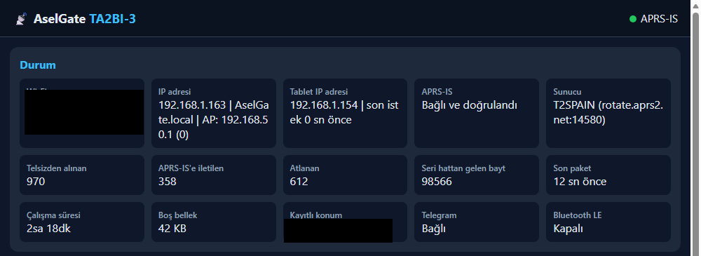
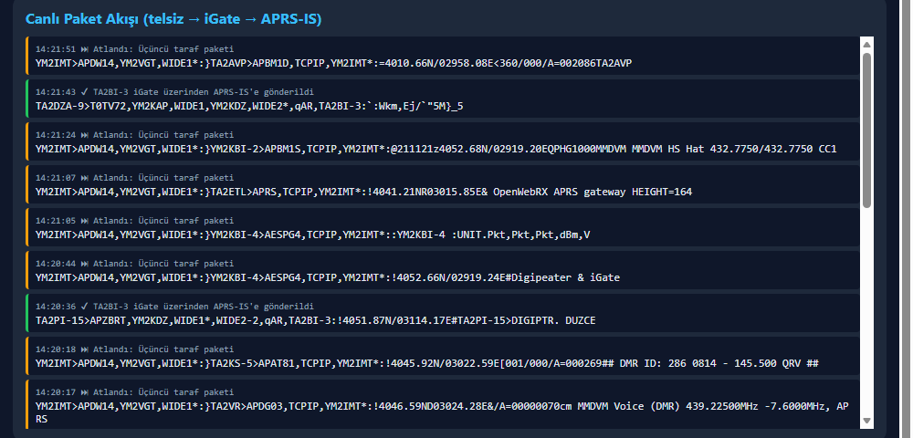
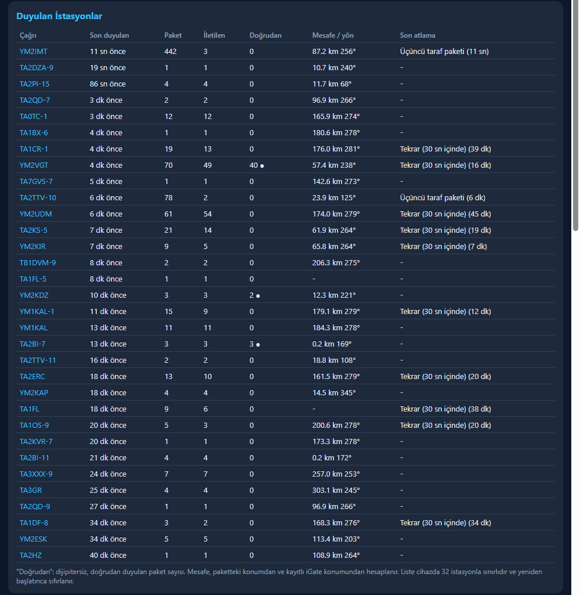
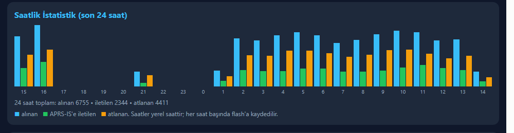

# AselGate iGate (ESP32-C3)

ESP32-C3 tabanlı APRS iGate. Aselsan 4000 serisi telsizin veri çıkışını dinler, APRS paketlerini
APRS-IS'e iletir. Bu depoda cihazın derlenmiş yazılımı, devre şeması ve cihaz web arayüzü
görüntüleri bulunur.

Tablet ya da bilgisayarda çalışan ekran uygulaması ayrı bir depodadır:
[AselGate Ekran](https://github.com/mozbey/AselGateEkran).

> Bu proje amatör telsiz (APRS) kullanıcıları içindir. APRS-IS'e yayın yapmak için geçerli bir
> amatör telsiz lisansı ve çağrı işareti gerekir.

TA7W öncülüğünden Aselsan 4000 serisi telsizlere yapılan yeni yazılım güncellemesinin ardından
gelen APRS IGATE özelliğini kullanabilmek için hazırladığım devre şeması ve yazılımı sizlerle
paylaşıyorum.

Kaynak kodu bu depoda yer almaz. Derlenmiş dosyalar
[sürüm sayfasında](https://github.com/mozbey/AselGate/releases) verilir.

## Donanım

- **Kart:** ESP32-C3 (ESP32-C3 Super Mini). Bu sürüm yalnızca ESP32-C3 için derlenmiştir.
- **Telsiz bağlantısı:** ASELSAN 4021 E telsizin Pin 7 (Tx veri) çıkışı, MAX3232 üzerinden ESP32
  GPIO5 (RX) girişine bağlanır. ESP32 yalnızca dinler, TX kullanılmaz.
- **GPS:** NEO-6M verisi MAX3232 üzerinden telsiz hattına gider. ESP32 bu veriyi yalnızca okur.
- **Devre şeması:** [`devre-semasi/AselGate-v4.pdf`](devre-semasi/AselGate-v4.pdf)

## Kurulum (ilk kez)

1. [Sürüm sayfasından](https://github.com/mozbey/AselGate/releases) `AselGate-v1.11.2-ESP32C3-tam.bin`
   dosyasını indirin.
2. Kartı USB ile bağlayın. Tarayıcıdan https://espressif.github.io/esptool-js/ adresine girin,
   "Connect" ile kartı seçin, dosyayı **0x0** adresine yükleyip "Program" deyin.
   Bu işlem kartta kayıtlı ayarları siler.
3. Alternatif (komut satırı): `pip install esptool`, ardından
   `esptool --chip esp32c3 --port COMx write-flash 0x0 AselGate-v1.11.2-ESP32C3-tam.bin`
   (Linux'ta port `/dev/ttyACM0` gibi olur.)

## İlk kullanım

1. Telefon ya da bilgisayarla **AselGate** adlı Wi-Fi ağına bağlanın. Şifre: `12345678`.
2. Tarayıcıdan http://192.168.50.1 adresini açın.
3. "Wi-Fi" bölümünden kendi ağınızı ekleyin.
4. "Ayarlar" bölümünden çağrı işaretinizi, passcode'unuzu ve konumunuzu girin, kaydedin.
5. Cihaz ağa bağlanınca http://AselGate.local adresinden de erişebilirsiniz.

## Web arayüzü

Cihazın web arayüzü (`http://AselGate.local` ya da cihazın IP adresi) durum, canlı paket akışı,
duyulan istasyonlar ve 24 saatlik istatistiği gösterir.

**Durum:** APRS-IS bağlantısı, sunucu, telsizden alınan ve APRS-IS'e iletilen paket sayıları.

**Canlı paket akışı:** Telsizden gelen paketler, iGate'in APRS-IS'e gönderdikleri ve atladıkları.

**Duyulan istasyonlar:** Çağrı işareti, son duyulma, paket sayısı, mesafe ve yön.

**Saatlik istatistik:** Son 24 saatte alınan, iletilen ve atlanan paketler.

> Ayarlar ve Wi-Fi bölümleri, şifre ve konum bilgisi içerdiği için buraya eklenmemiştir. Durum
> ekranındaki Wi-Fi adı ve kayıtlı konum karartılmıştır.

## Dikkat edilecekler

- **Varsayılan Wi-Fi şifresi (12345678) herkeste aynıdır.** Bu şifre arayüzden değiştirilemez,
  değiştirmek için yazılımın yeniden derlenmesi gerekir. Cihazı yalnızca kendi ağınızda ya da
  güvenilir bir yerde çalıştırın.
- **Yazılım kendi durum metnini ve telemetri başlığını taşır** ("ASELSAN iGate - yAtolye /TA2BI").
  Kendi istasyonunuzu kullanacaksanız bunu kendi çağrı işaretinizle yeniden derlemeniz gerekir.
- Passcode yanlışsa cihaz yalnızca alır, APRS-IS'e yayın yapamaz.
- APRS-IS'e yayın için geçerli bir amatör telsiz lisansı ve çağrı işareti gerekir.

## Sürümler

- **v1.11.2** (ESP32-C3): [sürüm sayfası](https://github.com/mozbey/AselGate/releases/tag/firmware-v1.11.2).
  `-tam.bin` ilk kurulum için, `-uygulama.bin` ağ üzerinden güncelleme için.

## Lisans

Lisans henüz belirlenmedi.
